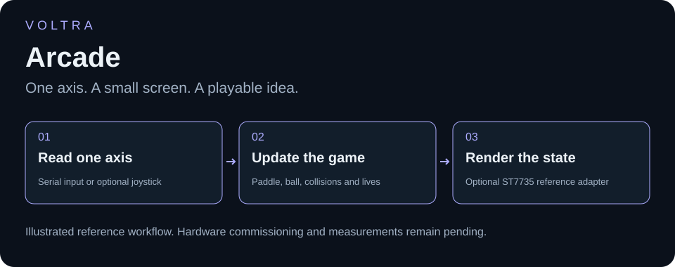
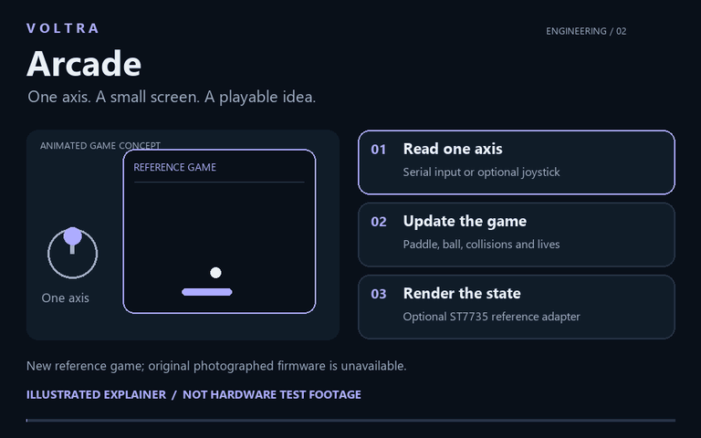
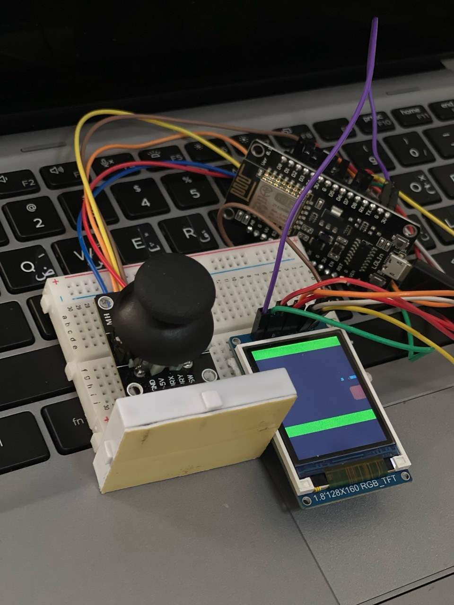

<h1 align="center">VOLTRA</h1>
<h2 align="center">Arcade</h2>

### Physical input. Visual feedback. Embedded electronics you can see.

## See the idea in motion

[Watch or download the 12-second explainer](media/walkthrough.mp4). An original, silent animation of the newly written paddle-game concept—not the original photographed game or a hardware demonstration. Physical joystick and display adapters are disabled by default.

## The real prototype

An embedded interface is where a user's movement meets a device's response. This compact breadboard build brings a **LoLin ESP8266 board, a two-axis joystick, and a 128×160-labelled colour TFT** into one physical prototype. Its powered, game-like screen gives the project a tangible visual identity beyond a serial terminal.

[Hardware](#visible-hardware) · [Evidence](#what-the-photograph-establishes) · [Source and wiring](WIRING_AND_SOURCE.md)

**New reference implementation:** [paddle-game firmware](FIRMWARE.md) with score, lives, collisions and restart. [Software checks](BUILD_STATUS.md) are recorded separately from the photograph; no claim is made that this is the original photographed game.

## Engineering focus

The hardware brings input, display, and power integration into the same small assembly. A reproducible implementation needs to explain how the joystick is read, how inputs map to screen behavior, and how the display is updated. These are the key design details the original firmware must establish—not performance results inferred from a photograph.

## Visible hardware

| Component | Visible quantity | Identification limit |
| --- | --- | --- |
| LoLin development board with ESP8266 module | 1 | Exact board revision unconfirmed |
| TFT module marked 1.8-inch, 128×160 RGB | 1 | Driver IC and interface wiring not verified |
| Two-axis joystick module with switch labels | 1 | Actual firmware use of axes/button unknown |
| Breadboard and jumper wires | 1 assembly | Connections cannot be fully traced in this view |
| White enclosure/module | 1 | Purpose unconfirmed; not labelled as a battery or controller |

## What the photograph establishes

The display is illuminated and contains coloured boundaries and small graphics. It does **not** prove that the joystick controls them, establish game rules, or show refresh rate or input latency. The sketch for this physical setup has not yet been located.

## Engineering documentation still to close

Confirm the display controller, joystick signal handling, exact pins, voltage requirements, and power source. The new code supplies a one-axis paddle-game reference with serial controls and an optional ST7735 adapter; hardware connections stay disabled/unset. Record a real input-to-display demonstration after commissioning. No guessed original GPIO table is provided.

The owner confirms that this photograph represents its own independent project. The ultrasonic-display build is documented separately. The round GC9A01 display sketch found elsewhere is **not** substituted for this rectangular TFT project. See the [source and wiring checklist](WIRING_AND_SOURCE.md).

## Tests, limitations, and next step

Current physical evidence: one genuine photograph. The new firmware compiles for its documented reference target and has standalone logic tests; these are [software results](BUILD_STATUS.md), not a dynamic joystick/TFT test. The next hardware milestone is a recording of actual input-to-display behavior.

Project author: [ali9235](https://github.com/ali9235). Independent hardware project with newly authored reference firmware; physical commissioning remains pending.
