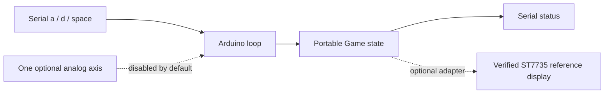

# VOLTRA Arcade: architecture and technical deep dive

Explore a compact direct-input screen interface with a small paddle-game reference. The photograph documents an assembled experiment, not proof that the newly authored sketch drove that assembly.

## System boundary

Solid arrows show implemented software flow or observed grouping. Dashed arrows identify optional, disabled or unverified paths. Neither is a recovered wiring schematic.

## Source and processing contract

| Layer | Source | Responsibility |
| --- | --- | --- |
| Configuration | [config.h](../firmware/joystick_display/config.h) | ADC/display gates and interface guards |
| Game | [game.h](../firmware/joystick_display/game.h) | Input mapping, collisions, score and lives |
| Adapter | [joystick_display.ino](../firmware/joystick_display/joystick_display.ino) | Timing, input collection and optional display |
| Verification | [test_core.cpp](../tests/test_core.cpp) | Portable game assertions |

Game::input(adc) clamps 0–1023 and maps to a 0–100 pixel paddle position on the 128-pixel reference field with a 28-pixel paddle. restart() resets score/lives and starts play; step() advances the ball, handles wall/paddle collisions and decrements lives when a ball is missed.

The reference supports **one analog axis**, not both. A nominal 20 ms step is a scheduling policy, not measured 50 FPS. There is no unbounded catch-up after a stall. Default serial a/d moves simulated input and space restarts; no physical switch adapter or network API exists.

The optional TFT is an ST7735 black-tab 128×160 reference, not a controller identified from a photo. Full-screen redraw may flicker. Development-board A0 scaling and bare-chip ADC limits must not be confused.

## Evidence boundary

No physical joystick response, TFT commissioning, measured FPS, two-axis input or wireless gameplay was demonstrated.

[Documentation index](ENGINEERING_STANDARD.md) · [Design decisions](DECISIONS.md) · [Security](../SECURITY.md)
